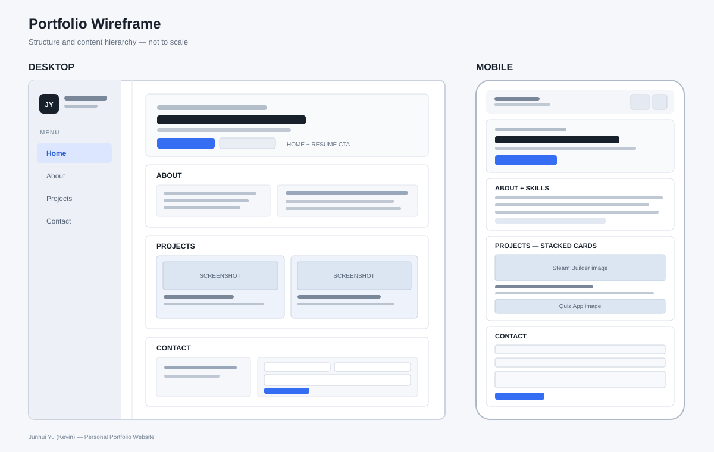

# Junhui Yu (Kevin) — Personal Portfolio Website

## Project Overview

This project is a personal portfolio website designed as a visual resume for Junhui Yu (Kevin). It presents my technical background, selected software projects, and contact information in a professional, easy-to-navigate format. The website is built from scratch with HTML, CSS, and JavaScript and is hosted on GitHub Pages.

## Target Audience

The primary audience is employers and recruiters looking for candidates for entry-level IT support, technology support, systems, networking, internships, and related junior roles.

## Content Strategy

The content is organized around the information employers are most likely to look for first: my name and career direction, my technical skills, evidence of work through projects, and ways to contact me. Text is kept concise so visitors can scan the site quickly. Project descriptions focus on each application's purpose, implemented features, and technologies rather than using unsupported skill ratings.

## Information Organization

The site is a single-page scrolling layout with a persistent sidebar on desktop and a collapsible navigation menu on smaller screens.

1. **Home** — Brief professional introduction, project navigation, and a resume download button.
2. **About** — A short bio and grouped technical skills.
3. **Projects** — Steam Builder and the Client-Server Quiz Application, with screenshots, feature descriptions, technology tags, and repository links.
4. **Contact** — Email, GitHub, LinkedIn, and a contact form that validates the information and opens a prefilled email draft.

The sidebar links jump to each section. JavaScript updates the active navigation item based on the section currently being viewed.

## Visual Design

- **Style:** Modern, minimalist, professional, and developer-focused.
- **Color palette:** White and light gray backgrounds, dark text, and blue accents. Dark mode uses dark navy surfaces and lighter text while retaining blue accents.
- **Typography:** Montserrat for headings and Open Sans for body text, loaded from Google Fonts.
- **Layout:** CSS Grid and Flexbox organize the page and project cards. Media queries adapt the layout for desktop, tablet, and mobile sizes.
- **Visual hierarchy:** Large headings establish the main topics; spacing, contrast, numbered project labels, and technology tags help users scan the content.
- **Images:** `SteamBuilder.PNG` and `QuizzApp.PNG` are used as project screenshots. Keep both image files in the same folder as `index.html`. The file names and capitalization must match the HTML exactly.
- **Consistency:** Shared styles in `styles.css` are used for navigation, buttons, project cards, form controls, color themes, and responsive behavior.

### Wireframe

The wireframe below is a computer-aided plan of the main desktop and mobile layouts. It represents the content order and general layout rather than exact pixel measurements.



## PART 1: CONTENT 

1. What is your full name as you want it displayed professionally?
Junhui Yu
2. What is the purpose of your portfolio website?
A Visual Resume
3. Who is the target audience (employers, clients, peers, etc.)?
The target audience is mainly Employers
4. What skills do you want to highlight?
Programming: JavaScript, HTML/CSS, SQL
IT/Systems: Windows & Linux administration, networking fundamentals, troubleshooting
Tools: Git/GitHub, VS Code, Microsoft 365, virtualization (VMware/VirtualBox)
Soft skills: problem-solving, documentation, teamwork, adaptability
5. What projects or work will you showcase?
PC Builder Application, Quiz Website
6. How will you describe yourself in a short professional bio?
I'm Junhui Yu, an aspiring IT professional with a strong foundation in programming, systems administration, and networking. I enjoy solving technical problems, learning new tools quickly, and building practical projects that turn ideas into working solutions. I'm currently seeking an entry-level IT role where I can contribute, grow, and continue developing my technical skills.
7. What pages will your site include (Home, About, Projects, Contact, etc.)?
Home, About, Projects and Contact
8. What is your career goal or desired role?
My current career goal is a entry level IT role.
9. What technologies or tools do you have experience with?
Languages: JavaScript, HTML, CSS, SQL
OS: Windows, Linux (Ubuntu)
Tools: Git/GitHub, VS Code, Microsoft Office, VirtualBox
Concepts: networking basics, troubleshooting, version control
10. What achievements or experiences are worth highlighting?
The highlights will be github projects and experience.
11. What call-to-action should visitors take (contact you, view projects, download resume)?
The primary call-to-action would be to download my resume and view projects, while the secondary would be to contact me.
12. Will you include a resume? In what format?
Yes, I'll include a resume
13. What social or professional links will you include (GitHub, LinkedIn, etc.)?
Github, Linkedin,and Email

--------------------------------------------------
## PART 2: DESIGN 

1. What overall style will best represent you (minimalist, creative, professional, etc.)?
The overall style of the webpage would be a modern minimalist design.
2. What color scheme will you use and why?
The color scheme will be a mix of White, Grey and Blue.
3. What fonts will you use for headings and body text?
For the fonts I'll be using Montserrat for the heading and Open Sans for the body.
4. How will your design reflect your personality or field?
The minimalist layout mirrors the clarity and efficiency expected in IT work;
5. What layout will your homepage follow?
The layout will be a single page scroll with the header being used for navigation.
6. How will you organize project sections visually?
The project section will be the middle part of the webpage, after the Home and About.
7. Will the site be mobile-friendly? How will you ensure responsiveness?
Yes, the site will be mobile-friendly and that will be insured by using Flexbox.
8. What visual hierarchy will guide visitors?
The Size, color, and spacing will guide the visitors eye top-to-bottom.
9. How will consistency be maintained across pages?
This will be achieved by using a single CSS sheet so all will follow the same format.
10. How will accessibility be considered (contrast, font size, readability)?
The background will be white with black text
11. Will you use icons, images, or illustrations? Why?
I will have small icons for links that
12. What portfolio websites inspired your design?
https://braydenfriesen.com/

--------------------------------------------------
## PART 3: INTERACTIVITY 

1. What interactive elements will your site include (navigation menus, buttons, forms)?
My site will include a sidebar that allows for quick navigation.
2. Will your site include a contact form? How will it work?
Yes, It will function as a contact where a potential employer can reach out by filling out a simple reason of interest form.
3. What JavaScript features will you implement?
For JavaScript I will include active-links,
4. How will users receive feedback from interactions?
There will be a message that users recive after interacting with the contact section
5. How does interactivity improve the user experience?
Interactivity allows for the user to be more engaged which improves user experience.

## Technical Overview

### Technologies

- **HTML:** Page structure, navigation, project cards, and contact form.
- **CSS:** Layout, typography, colors, dark theme, image handling, responsive design, and focus styles.
- **JavaScript:** Theme persistence, mobile navigation, active-section tracking, image fallback handling, contact-form validation, `mailto:` draft creation, and footer year.
- **Google Fonts:** Montserrat and Open Sans.
- **Hosting target:** GitHub Pages. No Node.js, package installation, or build command is required.

### Repository File Structure

```text
junhui-portfolio/
├── index.html
├── styles.css
├── script.js
├── Junhui Yu Resume.pdf
├── SteamBuilder.PNG     
├── QuizzApp.PNG           
├── wireframe.svg
└── README.md
```

Keep `SteamBuilder.PNG` and `QuizzApp.PNG` in the same directory as `index.html`. File names are case-sensitive on GitHub Pages. If either screenshot is renamed or moved, update its `src` attribute in `index.html` accordingly.

## Interaction and Functionality

- Sidebar links navigate to Home, About, Projects, and Contact.
- The active navigation item updates based on the visible page section.
- The mobile navigation menu opens and closes, and can be dismissed with Escape or by selecting a link.
- Light/dark mode can be switched by the visitor; the selection is stored in local browser storage when available.
- The resume link downloads `Junhui%20Yu%20Resume.pdf` as `Junhui-Yu-Resume.pdf`.
- The project screenshots display at their natural aspect ratio. If an image fails to load, the card displays a fallback placeholder.
- The contact form validates entries and prepares an email draft using `mailto:`. GitHub Pages does not process form submissions on its own.
- The footer year is filled in by JavaScript.

## External Resources

- **Design inspiration:** https://braydenfriesen.com/
- **Google Fonts:** https://fonts.google.com/ — Montserrat and Open Sans.
- **GitHub Pages documentation:** https://docs.github.com/en/pages/getting-started-with-github-pages/creating-a-github-pages-site
- **Steam Builder repository:** https://github.com/LoganARay/CSC325-Capstone
- **Quiz Application repository:** https://github.com/Yu-J26/quiz-app

## Timeline / Project Milestones

The following is a suggested project timeline. Adjust the weeks to match the actual course schedule and completion dates.

| Milestone | Main tasks | Deliverable |
|---|---|---|
| Week 1 — Planning | Define audience, purpose, content, and career goals; answer the content questionnaire. | Content plan and completed Part 1-3 questions |
| Week 2 — Design | Choose color palette, fonts, section order, responsive layout, and create the wireframe. | Design plan and `wireframe.svg` |
| Week 3 — Core development | Build the Home, About, Projects, and Contact sections with HTML and CSS. | Initial page layout and shared stylesheet |
| Week 4 — Interactivity | Add navigation behavior, dark mode, resume download, project image fallback, and contact-form validation. | Working JavaScript features |
| Week 5 — Testing and refinement | Test mobile and desktop layouts, links, screenshots, keyboard access, theme persistence, and form validation. | Reviewed site and final corrections |
| Week 6 — Deployment | Commit all project files to GitHub, enable GitHub Pages, and verify the published URL. | GitHub repository and live website URL for Brightspace |
